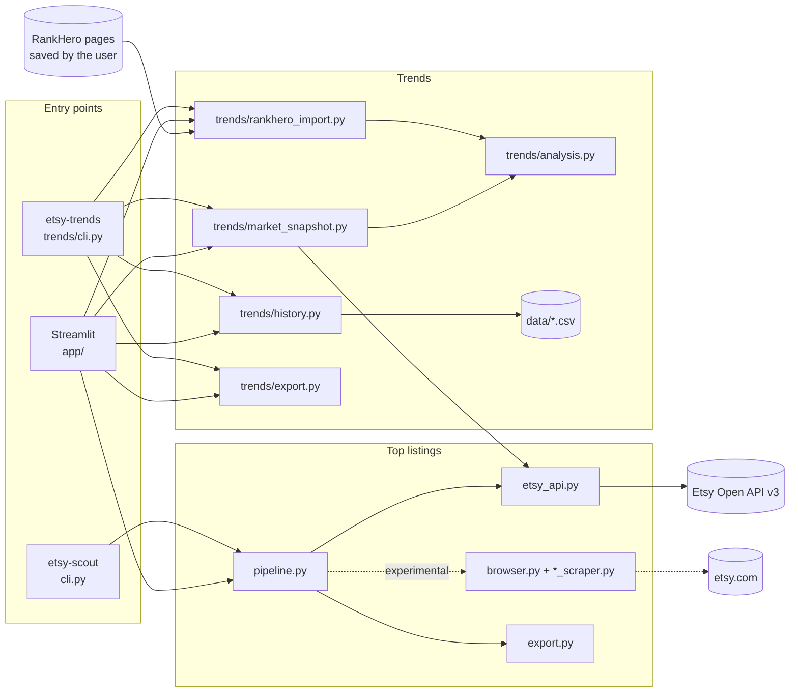

# Architecture

## Overview

Two command-line apps and one web app share a single Python package, `etsy_scout`.

## Modules

### Shared

| Module | Responsibility |
|---|---|
| `etsy_api.py` | Etsy Open API v3 client: API-key auth (`x-api-key: keystring:secret`), throttling, 429 retries, actionable 401/403 errors. Endpoints: `/listings/active` search, `/listings/batch`, `/listings/{id}/reviews`, `/shops/{id}`. Also converts responses into models. |
| `ranking.py` | Pure functions that turn API search results into a shopper-like top N: `expand_queries` (keyword + `related` + product-noun synonyms from `PRODUCT_SYNONYMS`), `core_terms` / `is_on_topic`, `popularity_key` (favorites, views, API position), and `rank_candidates`. |
| `fx.py` | Currency handling. `money()` parses Etsy money objects into (amount, currency). `FxRates` converts to USD using daily ECB rates from frankfurter.dev, fetched once per instance (`EtsyApi.fx`). |
| `parsing.py` | Pure helpers: counts like "10.8k", prices, ratings, ages, listing URLs, JSON-LD. |
| `models.py` | Pydantic models for top listings, and `TEMPLATE_COLUMNS`, the `competitor_listing` column order. |

### Top listings (`etsy-scout`)

| Module | Responsibility |
|---|---|
| `cli.py` | Typer command, option validation, and user-facing errors. |
| `pipeline.py` | `run(keyword, top_n, source, ...)`: picks the sources, collects `SearchHit` + `ListingDetails` + `ShopStats`, caches shops, and merges everything into `ListingRow` with `build_row`. The precedence rules live in `build_row`. |
| `export.py` | Builds the DataFrame in `COLUMNS` order and writes `.xlsx` (sheet `competitor_listing`) and `.csv`. |
| `browser.py` | *Experimental.* Playwright session on system Chrome with a persistent profile, block detection, and a pause so the user can clear a check. Never solves CAPTCHAs. |
| `search_scraper.py`, `listing_scraper.py`, `shop_scraper.py` | *Experimental.* Each has a pure `parse_*_page(html)` function (tested on fixtures) and a thin `scrape_*` wrapper. |
| `selectors.py` | Every CSS selector and text regex for etsy.com, in one place. |

### Trends (`etsy-trends`)

| Module | Responsibility |
|---|---|
| `trends/cli.py` | `urls`, `import-rankhero`, `snapshot`, and `report` commands. |
| `trends/rankhero_import.py` | `parse_rankhero_page(html)`. It reads JSON-LD (WebPage, Product, ItemList), the metric cards, the monthly `<table>`, the progress-bar `aria-label`s for price bands, and the country sections. **Never makes network calls.** |
| `trends/market_snapshot.py` | `take_snapshot(api, keyword)`: Etsy's total match count plus price stats for a sample. |
| `trends/analysis.py` | `summarize_trend` (seasonal / direction / YoY labels) and `price_stats` (quartiles and bands). Pure functions. |
| `trends/history.py` | CSV history in `data/`, with upserts keyed by keyword × source × date and keyword × month. |
| `trends/export.py` | DataFrames for each sheet and the workbook writer. |
| `trends/models.py` | `KeywordTrend`, `MarketSnapshot`, `TrendSummary`, and `TREND_TEMPLATE_COLUMNS`. |

### Web app

`app/Top_Listings.py` is the main page. `app/pages/*.py` are extra pages, which Streamlit discovers automatically and orders by their numeric prefix. Pages call the same functions as the CLIs. Keep business logic out of `app/`.

## Design rules

1. **Compliant data access only.** Use official APIs first. Don't scrape sites whose terms forbid it (RankHero), and don't try to evade bot detection (Etsy DataDome). Prefer user-driven imports where automation isn't allowed.
2. **Parse functions are pure.** Every `parse_*` takes HTML or JSON and returns models, so it can be tested on fixtures without network access.
3. **Templates are contracts.** `TEMPLATE_COLUMNS` and `TREND_TEMPLATE_COLUMNS` mirror the research workbook. Add new columns after them, and never reorder or rename them.
4. **Fail per row, not per run.** One bad listing logs a warning and leaves blanks. Auth and blocking errors stop the run with an actionable message.
5. **Local state is git-ignored.** That covers `output/`, `data/`, `.env`, and `.browser-profile/`.

## Data flow: `etsy-scout --source api`

1. `EtsyApi.search_hits` pages through `/listings/active` (`sort_on=score`) for every query from `ranking.expand_queries` (up to `pool_size` each), merges and deduplicates the results, tags each one with `_api_rank` and `_matched_query`, and ranks them with `ranking.rank_candidates` (on-topic, physical, English; then by favorites and views). With `rank_by="relevance"` it uses only the keyword, in API order.
2. `EtsyApi.listing_details` makes one `/listings/batch` call per 100 IDs, with `includes=Images,Videos,Shop,BuyerPrice` and `buyer_country=US`, plus one `/reviews` call per listing. Prices come from `buyer_price` (regular, sale, shipping), converted to USD by `fx.FxRates`. Views, favorites, tags, and materials come from the same response.
3. `EtsyApi.shop_stats` makes one `/shops/{id}` call per distinct shop, cached for the run.
4. `build_row` merges the results (API detail prices win over search-card prices), then `export.write_outputs` writes the files.

To see every step with real data, run `notebooks/01_etsy_api_walkthrough.ipynb`.

## Data flow: `etsy-trends import-rankhero`

1. `import_rankhero_files` parses each saved page and keeps the newest copy per keyword.
2. `history.merge_monthly` upserts each monthly series. Then `summarize_trend` re-labels each keyword using its **full** stored series, which is how YoY appears after 24 months.
3. `history.append_history` records one row per keyword, then the workbook is written.
